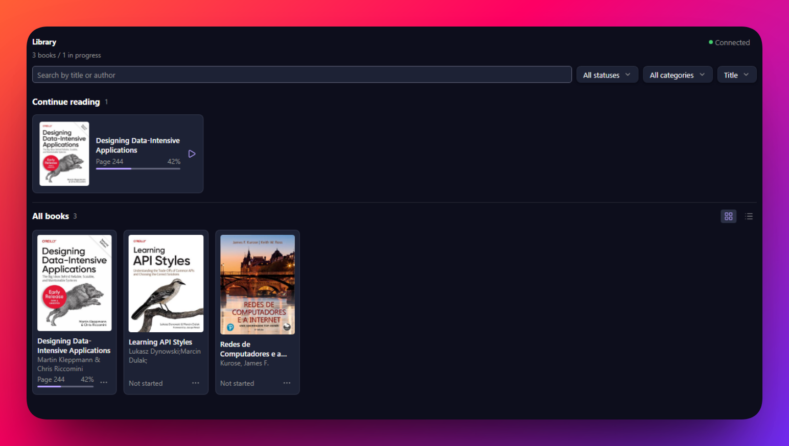

# Obsidian Library

Browse your PDF collection in Obsidian, resume reading from your last saved page, and keep study notes linked to your books. Your PDFs stay in a folder on your desktop or on a server you run.

[Desktop reading progress and book grid](docs/images/desktop-reading.png)

## Features

- **Browse your library.** Search by title or author, filter by category or reading status, and switch between grid and list views.
- **Resume reading.** Return to your saved page, confirm it manually, or mark a book finished.
- **Organize books.** Add favorites, edit titles and categories, or hide books from the catalog.
- **Take study notes.** Link books to vault folders and create Markdown notes from an optional template.
- **See metadata and covers.** In server mode, use PDF metadata, generated covers, or your own cover images.

## Installation

The manifest declares Obsidian **1.8.0** or later. Install [PDF++](https://github.com/RyotaUshio/obsidian-pdf-plus) from **Settings → Community plugins**, enable it, and turn on its external PDF support.

Once the plugin is listed, search for **Obsidian Library** in **Community plugins**, then select **Install** and **Enable**.

### Manual installation

1. Download the ZIP from [GitHub Releases](https://github.com/Klawns/obsidian-library-plugin/releases) or [build from source](docs/development.md).
2. Copy `manifest.json`, `main.js`, and `styles.css` into `.obsidian/plugins/obsidian-library/` inside your vault.
3. Reload Obsidian and enable **Obsidian Library** under **Settings → Community plugins**.

## Getting started

1. Run **Obsidian Library: Open library** from the command palette or select the library icon in the ribbon.
2. Choose **Set up library**. On desktop, select **Local folder**, enter the full path to your PDF folder, and select **Load books**. For mobile or shared access, follow the [server setup guide](docs/server-setup.md), then select **Remote server**, enter its HTTPS address, and select **Test connection**.
3. Open a book. Select **New note** to create a study note, or use **⋯ → Link folder…** to associate the book with a vault folder.
4. Select **Refresh** after adding PDFs. Remote books appear after the server indexes them.

## Integrations

- **PDF++** opens the external PDF references and provides the viewer used to capture reading progress.
- **Fast Note Sync** is optional. Sync Markdown under your [library data folder](docs/configuration.md#data-storage) and any linked study folders to share the remote catalog, reading progress, preferences for individual books, and notes.

## Privacy and security

Local mode reads the selected PDF folder. Remote mode contacts your configured HTTPS server for health checks, the catalog, covers, and PDFs. The plugin contains no telemetry code.

Obsidian stores plugin preferences and the server address in plugin data. The selected local folder and device identifier are kept in device-local storage. Vault files can contain book metadata, reading history, and references with absolute file paths or server URLs. Syncing those files shares that information with the configured sync destination.

The server has no built-in authentication. Restrict access to trusted devices using a private network or an access-controlled proxy.

## Documentation

[Server setup](docs/server-setup.md) · [Advanced configuration](docs/configuration.md) · [Compatibility](docs/compatibility.md) · [Development and contributions](docs/development.md)

## License

This repository has no declared license.
