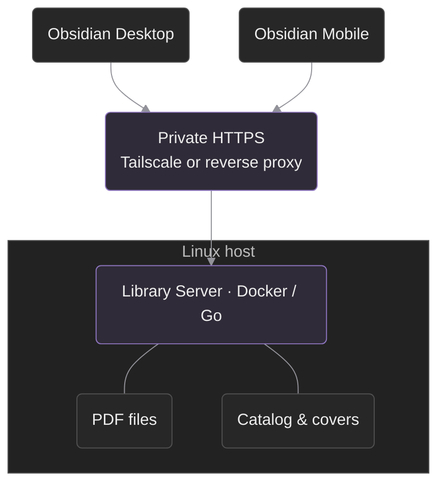

# Server setup

Use **Remote server** to browse your library from Obsidian desktop or mobile. Run the library server on a Linux host that can read your PDFs.



## Prerequisites

- Linux with Docker Engine running, the Docker Compose plugin, and Python 3.10 or later. The installer uses `sudo` for Docker commands when run as a regular user.
- A PDF folder on the server and a separate, writable directory for server state. Mount shares hosted on another machine in Linux first. A Samba share hosted on the server can be entered directly and requires Samba's `testparm` command.
- A private HTTPS address with a certificate trusted by your Obsidian devices.

## Private HTTPS

Connect the Linux host and each Obsidian device to your Tailscale network. Run the following on the Linux host. Enable HTTPS certificates if prompted, then copy the HTTPS address printed by Serve. [Tailscale Serve documentation](https://tailscale.com/docs/reference/tailscale-cli/serve)

```sh
sudo tailscale serve --bg http://127.0.0.1:8091
tailscale serve status
```

You can also use an existing private HTTPS proxy on the host. Forward the root of its HTTPS address to `http://127.0.0.1:8091`. Keep the service on loopback and limit access to trusted devices. The server has no built-in authentication. Avoid public port forwarding and Tailscale Funnel.

## Installation

### Docker Compose

Run the installer from the repository root.

```sh
python3 server/scripts/instalar-biblioteca.py
```

Enter the absolute Linux path to the PDFs or a local Samba share such as `//linux-host/books`. Enter a state directory outside the PDF folder. If it needs to be created, use an existing parent directory you can write to. Enter the private HTTPS address, such as `https://library.example.ts.net`, and confirm the configuration.

The installer prepares the `.obsidian-library` marker, checks Compose and container access, writes `.env`, and starts the server. It needs write access to the PDF folder if the marker is absent. Compose mounts the PDFs read-only.

For manual setup, copy [`.env.example`](../.env.example) to `.env` and set the folder and HTTPS values. Create the marker and give the configured container user read access to the PDFs and marker and write access to the state directory. Run `docker compose up -d --build` from the repository root.

### Native Linux with systemd

Install Go 1.25 or later and Poppler for PDF metadata and cover generation. From the repository root, build and install the binary.

```sh
cd server
go build -trimpath -o obsidian-library .
sudo install -m 0755 obsidian-library /usr/local/bin/obsidian-library
```

Create an `obsidian-library` system user and group with read access to the PDFs and their `.obsidian-library` marker. Use a path outside home directories because the unit restricts home directory access. From the `server` directory, install and edit the environment file and install the systemd unit. The unit creates the default state directory under `/var/lib/`.

```sh
sudo install -m 0644 .env.example /etc/obsidian-library.env
sudoedit /etc/obsidian-library.env
sudo install -m 0644 obsidian-library.service /etc/systemd/system/obsidian-library.service
sudo systemctl daemon-reload
sudo systemctl enable --now obsidian-library
```

## Connect from Obsidian

1. Open the HTTPS address with `/health` appended on the device running Obsidian. Wait until `catalogReady` is `true`.
2. In **Set up library**, choose **Remote server**. Paste the private HTTPS address without `/health`, then select **Test connection**.
3. Open a book with PDF++. Select **Refresh** after the server indexes newly added PDFs.

## Maintenance

Run Compose commands from the repository root. Use `sudo` if your user needs it to access Docker.

- To change the PDF folder, run `python3 server/scripts/configurar-biblioteca.py` and follow the prompt.
- After remounting the PDF disk, run `docker compose up -d --force-recreate` to refresh the bind mount.
- See [advanced configuration](configuration.md#server-options) for scan intervals and cover settings.

## Backups

Back up `catalog.json` from the state directory to preserve book IDs used by existing notes. Keep copies of your PDFs and vault separately.

## Troubleshooting

- If `/health` is unreachable, check private network access and certificate trust on the device running Obsidian.
- If `catalogReady` stays `false`, check that the PDF mount and marker are readable. View logs with `docker compose logs obsidian-library` or `sudo journalctl -u obsidian-library` for systemd.
- On Windows, choose **Local folder** for paths like `C:\Books` or `\\files.home\shares\books`. Obsidian may ask for permission to access the network host when PDF++ first opens a book from a share.
